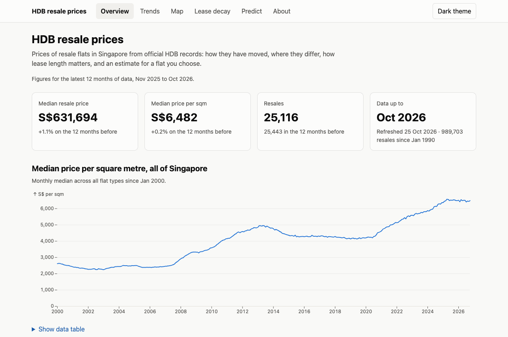
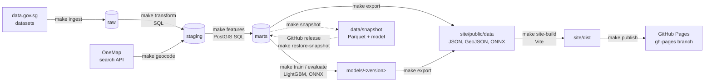

# sghousing: Singapore HDB resale price explorer and predictor

A local data platform and static website for Singapore HDB resale flat prices. The pipeline
downloads official data, cleans and enriches it in Postgres + PostGIS, trains a price model
with an uncertainty range, and exports everything to a static site that runs predictions in
the browser.

**Live site: <https://qwertyblob.github.io/sghousing/>**



## Architecture



Postgres + PostGIS runs in Docker with three schemas: `raw` (downloads as published),
`staging` (cleaned, typed and geocoded) and `marts` (features and aggregates). Python
downloads, geocodes, trains and exports; whole-table transforms are SQL files in `sql/`. The
site is static: charts and the map read the exported JSON, and Predict runs the ONNX models
in the browser, so there is no server to run.

## Prerequisites

- [Docker Desktop](https://www.docker.com/products/docker-desktop/) (Compose v2)
- [uv](https://docs.astral.sh/uv/) (installs Python 3.12 for you)
- Node 22 LTS (for the site and the ONNX parity test)
- For the full pipeline only: a free [OneMap API account](https://www.onemap.gov.sg/apidocs/register)
- For the snapshot route only: the [GitHub CLI](https://cli.github.com/) (`gh`), or download
  the release assets from the repository's Releases page by hand
- GNU Make (macOS ships 3.81, which is fine; Windows: use WSL2)

### Apple Silicon

The database image `postgis/postgis:16-3.4` is published for amd64 only, so Compose pins
`platform: linux/amd64`. For acceptable speed, enable **Docker Desktop → Settings → General →
"Use Rosetta for x86_64/amd64 emulation on Apple Silicon"**. Without it Docker falls back to
QEMU, which works but is noticeably slower for spatial queries.

## Quickstart

```bash
git clone git@github.com:qwertyblob/sghousing.git
cd sghousing
make setup      # Python 3.12 + locked deps, .env, git hooks
make db-up      # Postgres/PostGIS on 127.0.0.1:5432, schemas raw/staging/marts
make db-check   # verify Python can reach the database
make test
```

### Changing the database port

If port 5432 is taken (e.g. by Postgres.app), set **both** in `.env`:

```
POSTGRES_PORT=55432
DATABASE_URL=postgresql+psycopg://sg:sg@localhost:55432/sg_housing
```

Settings validation refuses to start if the two disagree.

### Route 1: full pipeline (from the official sources)

Put your OneMap login in `.env` (`ONEMAP_EMAIL`, `ONEMAP_PASSWORD`; `make setup` created the
file from `.env.example`). Then:

```bash
make all          # ingest, transform, geocode, features, check, train, evaluate, export
make site-build   # tests and the static build in site/dist
make site-dev     # or browse it at http://localhost:5173/sghousing/
```

`make all` starts from an empty database and needs no other manual step. Geocoding caches
every address in `staging.geocode_cache`, so a rerun only looks up new addresses. Training
picks the model version from the latest month of data, so a rerun on new data adds a
version under `models/` rather than replacing one.

### Route 2: from a data snapshot (no OneMap account, no training)

Each snapshot is a GitHub release holding the `marts` tables, the export's other inputs and
the trained model (see [Snapshots](#snapshots)). With `gh` installed:

```bash
gh release list --repo qwertyblob/sghousing          # pick the latest snapshot-YYYY-MM
gh release download snapshot-2026-10 --repo qwertyblob/sghousing --dir data/snapshot
make restore-snapshot   # load it into Postgres (replaces those tables) and restore the model
make export
make site-build
```

On an M2 MacBook this takes about two and a half minutes after the download (about 150 MB),
and the exported site data is byte-identical to the export the snapshot was taken from.

## Make targets

Run `make help` for the current list.

| Target | What it does |
|---|---|
| `setup` | Install Python 3.12 and locked dependencies, create `.env`, install git hooks |
| `db-up` / `db-down` | Start (and create schemas) / stop the database |
| `db-shell` | psql inside the container |
| `db-reset` | Destroy the database volume and recreate it empty |
| `db-check` | Connect from Python via `DATABASE_URL`, check PostGIS and schemas |
| `test` / `test-db` | Unit tests / database integration tests |
| `lint` | Ruff lint and format check |
| `ingest` … `features` | Pipeline stages (Phases 1–4) |
| `export` | Site data and models to `site/public/data`, validated against `site/src/schemas` |
| `eda` | Run the EDA notebooks and save their figures (outputs are not written back) |
| `train` | Baselines, tuning, calibration and final LightGBM models; ONNX export to `models/<version>` |
| `evaluate` | Test metrics, SHAP figures, model card, then the Node ONNX parity test |
| `site-dev` | Serve the site at http://localhost:5173/sghousing/ with live reload (needs `make export` first) |
| `site-build` | Site unit tests, type check, and the static build in `site/dist` |
| `publish` | `export`, then `site-build`, then push `site/dist` to the `gh-pages` branch (set `PAGES_REPO` to publish elsewhere) |
| `snapshot` | Write the snapshot to `data/snapshot` and print the `gh release create` command to publish it |
| `restore-snapshot` | Check a downloaded snapshot's checksums, load it into Postgres and restore its model |
| `all` | Ingest through export, in order |
| `clean` | Remove caches and build output (keeps data and DB) |

## Ingestion

`make ingest` downloads every dataset in data.gov.sg collection 189 (HDB resale prices; the
dataset list is read from the collection metadata on each run) plus the reference datasets in
`pipeline/ingest/reference.py`, and loads them into `raw` tables with every source value kept
as text. Re-running is safe: unchanged files are skipped by SHA-256 and a changed file replaces
that dataset's rows in a single transaction. A file with no data rows (a header-only CSV or
an empty GeoJSON) is treated as a broken refresh: ingest fails and the rows already loaded
are kept.

- **API key (optional).** Set `DATAGOV_API_KEY` in `.env` for higher rate limits. It is sent
  only to the data.gov.sg API hosts, never to the storage URLs files are downloaded from.
- **Rate limits.** data.gov.sg's own pages disagree (5 requests/minute vs 2 per 10 seconds
  without a key), so the client adapts instead: it retries 429/5xx responses, honouring
  `Retry-After`, with exponential backoff.
- **Snapshots.** Files land in `data/raw/{source}/{dataset_id}/` as
  `{YYYY-MM-DD}_{sha256}.{csv|geojson}` with a `.meta.json` sidecar, and are never overwritten.
  `current.json` names the snapshot in use. A dataset already retrieved today is reused without
  downloading; `uv run python -m pipeline.ingest --force-download` fetches again.
- `--only resale|reference|<key>` limits a run to part of the data.

### Adding a new reference dataset

1. Find the dataset on data.gov.sg and confirm its ID with
   `curl https://api-production.data.gov.sg/v2/public/api/datasets/<id>/metadata`.
2. Add a `ReferenceDataset(key, dataset_id, description)` entry to `REFERENCE_DATASETS` in
   `pipeline/ingest/reference.py`, with a comment linking to
   `https://data.gov.sg/datasets/<id>/view`.
3. Run `make ingest`. CSVs load as text columns and GeoJSON as `properties jsonb` plus
   `geometry_geojson text`, into `raw.ref_<key>`.

## Staging transforms

`make transform` runs the numbered SQL files in `pipeline/sql/` (`0*` then `1*`), turning
`raw` text tables into typed `staging` tables. Every table is dropped and rebuilt, so
re-running gives the same result. Parsers are strict: a value in a shape not seen before stops
the build with an error instead of becoming NULL.

`staging.hdb_resale` has one row per raw row (no de-duplication, because the source has no
unit numbers, so identical-looking rows can be separate sales):

- `txn_id` is `md5(source_dataset_id:source_row_number)`.
- `date_basis` is `approval` before March 2012 and `registration` from then on, matching
  HDB's change in what the month means.
- `remaining_lease_months` is the reported value where the source has one (2015 onwards).
  Otherwise it is computed as 99 years minus the months since January of the lease start year.
  `remaining_lease_basis` records which.
- `flat_type` merges `MULTI GENERATION` into `MULTI-GENERATION`. `flat_model` uses one
  spelling per model, the mixed-case form where one exists (`MODEL A` becomes `Model A`).
- `address_key` is `BLOCK STREET_NAME`, uppercased with whitespace collapsed, and matches
  `staging.hdb_block_info.address_key`.

Reference tables (`mrt_exits`, `planning_areas`, `hawker_centres`, `parks`, `schools`,
`hdb_block_info`, `resale_price_index`) store geometry in SVY21 (EPSG:3414, metres) with GiST
indexes. Schools have no coordinates in the source; they are geocoded in Phase 3.

## Geocoding

`make geocode` looks up every HDB block (`address_key`) and every school postal code with the
[OneMap search API](https://www.onemap.gov.sg/apidocs/) and caches the results in
`staging.geocode_cache`. The cache is never dropped by `make transform` or `make geocode`.

- **Credentials (required).** OneMap needs an API token. Register at
  <https://www.onemap.gov.sg/apidocs/register>, then set `ONEMAP_EMAIL` and `ONEMAP_PASSWORD`
  in `.env`. The token is fetched and refreshed automatically and is never logged.
- **Matching.** The first query is `"{block} {street_name}"`. A result is accepted when its
  `BLK_NO` equals the block and its road name equals the street once abbreviations are
  expanded (`AVE` becomes `AVENUE`, `BT` becomes `BUKIT`, and so on; see `ABBREVIATIONS` in
  `pipeline/geocode/onemap.py`). If nothing matches, a second query with the abbreviations
  expanded is tried (status `fallback`). Schools are matched on postal code.
- **Demolished blocks.** Blocks OneMap no longer knows (mostly redeveloped estates) are placed
  at the centroid of the located blocks on the same street (status `approx`). This is
  recomputed every run. Blocks on streets with nothing located stay `failed`.
- **Overrides.** Rows in `data/manual/geocode_overrides.csv`
  (`address_key,lat,lon,postal,note`) are applied last with status `override`, and those
  addresses are never queried.
- **Resumable and rate limited.** Requests are spaced to `GEOCODE_REQUESTS_PER_SECOND`, and
  results are committed every 100 addresses. A stopped run resumes where it left off, and a
  fully cached run makes no API calls. `failed` and `approx` addresses are not queried again
  automatically; use `uv run python -m pipeline.geocode --retry-failed`, or add an override.
- **Failures** (`approx` and `failed`) are written to `reports/geocode_failures.csv`
  (not committed).

## Spatial features

`make features` runs `pipeline/sql/2*.sql` to build three tables in `marts`:

- `marts.block_generations`: one row per building generation at an address (see "Block
  facts" below), with `block_max_floor`, `block_year_completed` and `block_info_source`.

- `marts.block_features`: one row per located block.
  - Columns: `lat`, `lon`, `planning_area`, `region`, `dist_mrt_m`, `nearest_mrt_name`,
    `n_mrt_exits_500m`, `n_primary_schools_1km`, `dist_nearest_primary_m`, `dist_hawker_m`,
    `dist_park_m`, `dist_cbd_m` (to Raffles Place MRT), `block_max_floor` and
    `block_year_completed`.
  - It also carries `geocode_status` (`approx` means a street-centroid location) and
    `block_info_source`.
  - Every column is NOT NULL, so a missing feature fails the build.
- `marts.resale_features`: one row per transaction. It has the staging columns plus the block
  features, `block_generation`, `month_index` (months since January 1990) and `rel_storey`
  (storey over the block's top floor, capped at 1). Block facts and `rel_storey` come from the
  sale's own building generation, so they are filled for every sale, including the few on
  blocks that could not be located.

Choices worth knowing:

- **MRT only.** MRT distances and counts use exits that lead into an MRT station. At the
  Punggol, Choa Chu Kang and Bukit Panjang interchanges, LTA labels some of these exits with
  the LRT station's name, and they are included. Stand-alone LRT stations are not.
- **Hawker centres.** Those still under construction are excluded.
- **Parks.** Distances are to the park edge, so a block inside a park gets 0.
- **Block facts.** A demolished block's number is sometimes reused for a new building: 21
  Teban Gardens Road was a 15-storey block from 1978 and is now a 40-storey block completed
  in 2012. Sales at an address are grouped into generations by lease start year. A new one
  starts only when the lease start year jumps by more than 3 years and every earlier sale
  happened before that year. A jump while the older lease is still being sold (37 Teban
  Gardens Road) is treated as the same building. HDB property information describes today's
  building, so it is used only for the latest generation, and only if it is residential and
  completed no later than that generation's first resale. Otherwise the highest storey sold and the
  earliest lease start year are used (`block_info_source = 'transactions'`).
- **Amenities are today's.** A station or hawker centre that opened in 2020 also counts for a
  1995 sale.

`uv run python -m pipeline.geocode.spot_check` compares five blocks' stored `dist_mrt_m` and
`nearest_mrt_name` with OneMap's nearest-MRT service. A block passes when the station matches
and the distances differ by at most 75 m. OneMap measures to a single station
point, which lies up to about 60 m from the exits these features use. It needs OneMap
credentials.

## Data quality

`make check` runs `tests/test_data_quality.py` against the live database (after
`make features`) and writes [`reports/data_quality.md`](reports/data_quality.md). The report is
written before any assertion, so a failing run still explains itself, and it depends only on
the data, so re-running it without new data changes nothing. A missing input table, or one with
no sales, fails the run instead of skipping it. `make test-db` leaves this gate out and runs
`tests/test_quality_checks_db.py` instead, which injects faults into small copies of the
tables to test each check. The checks, defined in
`pipeline/quality/checks.py`:

| Check | Fails when |
|---|---|
| Row counts per year | Any month between the first and last has no sales, or a year has under half the previous year's sales. Only the partial first and last years are scaled to 12 months. |
| Nulls | Any required column in `staging.hdb_resale` or `marts.resale_features` has a NULL. |
| Ranges | `floor_area_sqm` is outside 25–300, `resale_price` is not above 0, or `storey_mid` is outside 1–60. |
| Known values | A `flat_type` or `town` is not in the known list (7 flat types; HDB's 26 towns plus Lim Chu Kang). |
| Geocode coverage | Under 99.5% of addresses are located, or any sale since 2015 is not. |
| Feature coverage | Checked per sale: the mart and staging hold different `txn_id`s, a sale's `geocode_status` disagrees with the geocode cache, a location feature is NULL on a located sale or set on an unlocated one, or a block fact is NULL. |
| Price outliers | Never: they are flagged, not failed. No outliers is a pass. |

Two judgement calls:

- **Terrace houses.** Two sales are above 300 sqm. Both are HDB terrace houses in Whampoa,
  whose floor area includes their land (366.7 sqm sold for $1.568M in 2024). Only Terrace
  sales in Kallang/Whampoa between 300 and 400 sqm are allowed, and the report lists them.
  Anything else outside 25–300 sqm fails, such as a terrace outside Whampoa or above 400 sqm.
- **Price outliers.** A sale is flagged when its price per sqm is more than 4 scaled median
  absolute deviations from the median of its town, flat type and year. The MAD is scaled by
  1.4826 so that it estimates the standard deviation, which makes the limit about 4 robust
  standard deviations.
  Groups whose MAD is 0 (a few tiny groups) are not scored. The report gives counts by flat
  type and the 25 most extreme sales.

## Exploratory analysis

The notebooks in `notebooks/` read the `marts` tables through `pipeline/eda/data.py`, which
does the aggregation in SQL. They plot with `pipeline/eda/figures.py`. `make eda` executes them
into a temporary directory, so the committed notebooks stay free of outputs (a unit test
checks this). Each figure is saved as PNG and SVG in `reports/figures/` without timestamps,
so re-running on the same data rewrites identical files. The findings are in
[`reports/eda_summary.md`](reports/eda_summary.md).

| Notebook | Analyses |
|---|---|
| `01_prices_and_volume` | Median price per sqm by flat type (2012 dating change marked); transactions per month with market events |
| `02_towns_and_map` | Town ranking over the latest 12 months with 2-year change; planning-area choropleth |
| `03_price_drivers` | Lease decay, floor-level premium and distance to the MRT, each relative to similar flats (same town, flat type and year) |
| `04_feature_associations` | Spearman correlation and mutual information of each feature with log price |

To explore interactively, run `uv run jupyter lab`, then clear outputs before committing.

## Modelling

`make train` (`pipeline/train/train_lgbm.py`) fits models on sales from 2015 onwards, split by
month: training up to `TRAIN_END` (2023-12), validation up to `VALID_END` (2024-12), and test
after that.

- **Target and features.** The target is `log(resale_price)`. Categorical features are town,
  flat type, flat model and planning area, as fixed integer codes stored in `features.json`
  and handled by LightGBM's native categorical splits (`tests/test_onnx_categorical.py`
  checks that ONNX supports them). Numeric features are the flat, block and location features
  plus leak-free rolling medians. `pipeline/sql/205_marts_rolling_features.sql` computes the
  town and flat type median price per sqm over the 3, 6 and 12 months before the sale, and
  the block's median and count over 24 months. `tests/test_rolling_features.py` proves that
  later prices cannot change them.
- **Baselines.** The prior-12-month town and flat type median price per sqm times floor area,
  and a ridge regression with one-hot categoricals.
- **LightGBM.** A random search over 30 parameter sets for the median (quantile 0.5) model,
  scored by validation MAE, then p10 and p90 models with the same parameters.
- **Interval calibration.** Raw quantile intervals cover only 54–73% of prices in the year
  after training, missing above p90 in rising markets and below p10 in falling ones. A
  yearly backtest predicts each year from 2019 to 2024 with models fit on the years before
  it. Conformalized quantile regression then widens both bounds by the amount that brings
  those out-of-sample prices to 80% (2.1% for model 2026-10). See `pipeline/train/calibrate.py`.
- **Final models.** Refit on training plus validation with the tuned parameters, with the
  widening baked into the p10 and p90 models.
- **Export.** Each model is exported to ONNX (`model_p10/p50/p90.onnx`, float32 input
  `input`, output log price) together with `features.json`. Split thresholds are first
  rounded to float32, because the double thresholds LightGBM uses otherwise send some rows
  down the other branch in ONNX. The export is checked against LightGBM (largest difference
  1.7e-5 in log price).

`make evaluate` (`pipeline/train/evaluate.py`) scores the test split and writes:

- `models/<version>/metrics.json`
- SHAP figures in `reports/figures/shap_*`
- the model card, `models/<version>/model_card.md`

It then runs the parity test: 200 test rows go through Python onnxruntime and
onnxruntime-node (`tests/parity/`), and every relative difference must be below 1e-4. Only
the model card is committed; models, metrics and parity cases are generated.

To price one flat with the latest model:

```bash
uv run python -m pipeline.cli predict --block 122 --street "ANG MO KIO AVE 3" \
    --flat-type "4 ROOM" --area 92 --storey 10
```

The CLI looks up the town, lease, flat model and block features from the database, computes
the rolling medians for the month after the latest data, and prints p10, p50 and p90. The
storey is mapped to the middle of its 3-storey range, as the data records it.
`tests/test_predict_db.py` checks that the CLI rebuilds recorded sales' features exactly as
in training.

## Site data

`make export` writes `site/public/data/` (generated, not committed). It builds the files
next to the old directory and validates them before swapping them in. Validation checks
every file against its JSON Schema (Draft 2020-12) in `site/src/schemas/`, checks that
`meta.json` lists exactly the town files and models present, and checks the size budget:
under 60 MB in total and under 1 MB for the GeoJSON. A failed or invalid export leaves the
previous files in place. `make export` then reruns the same checks on the published
directory with `pytest -m site_data`.

| File | Contents |
|---|---|
| `meta.json` | Coverage, last refresh, the month being priced, model version and test metrics, town file list, sources, licence, geocoder credit, disclaimer |
| `overview.json` | The national monthly series and the latest 12 months against the 12 before, by flat type: 11 KB, so the landing page loads fast |
| `town_month.json` | `marts.agg_town_month` from 2000: sales, median price per sqm and median price by town, flat type and month, with `ALL` rollups |
| `planning_areas.geojson` | URA planning areas simplified with `ST_SimplifyPreserveTopology` (5 m): 12-month median price per sqm, the previous 12 months, year-on-year change (only where both windows have at least 20 sales), and a yearly trend from 2015 |
| `lease_decay.json` | `marts.lease_decay_curve`: median price per sqm, and relative to its town, flat type and year, by whole years of remaining lease over the latest 5 years (bins with at least 30 sales) |
| `blocks.json` | Every located block with a resale since 2015 and its model inputs for the month being priced: lease, building, distances and the 24-month block median. Also town-level 3/6/12-month medians and the usual flat model for each town and flat type |
| `recent/{town}.json` | The last 24 months of sales in a town |
| `model/` | `features.json` of the latest model and its `model_p10/p50/p90.onnx.gz`, gzipped (7.3 MB instead of 42 MB) because static hosts do not compress `.onnx` files; the site decompresses them in the browser |

All files are minified JSON. Months are written as `"2026-10"` and timestamps as full ISO
8601. Large tables are columnar, `{"columns": [...], "rows": [[...], ...]}`, rather than
one object per row. The site turns a block and flat details into a model input from
`blocks.json` alone. Model inputs (coordinates, distances, rolling medians) are written
unrounded, because a rounded value can fall on the other side of a tree split.
`tests/test_site_export.py` checks that a sample of rows match exactly what the CLI computes
from the database. Planning area boundaries are snapped to a 1e-5 degree grid with
`ST_ReducePrecision`, which keeps them valid; rounding coordinates alone made 6 of the 55
self-intersect or collapse.

`blocks.json` carries HDB's reported remaining lease forward to the month being priced
(`as_of`). This is more accurate than recomputing it from the lease start year. For a later
month, the site subtracts the months elapsed since `as_of`.

The whole directory is 17 MB. The export removes the optional `nodes_hitrates` attribute
from the ONNX models (13% smaller before gzip); predictions are unchanged and are checked on
every export.

## Website

`site/` is a static site built with Vite and TypeScript (no framework). It reads everything
from `data/`, has no backend, and is served from `/sghousing/` (set `SITE_BASE` to change
it). Pages are switched with hash routes, and filters are kept in the URL, so a view can be
bookmarked or shared (for example `#/trends?town=BEDOK&type=4 ROOM`).

| Page | What it shows |
|---|---|
| Overview | Median price, price per sqm and resales over the latest 12 months against the 12 before, the national monthly trend since 2000, a table by flat type, and how fresh the data is |
| Trends | Town and flat type pickers driving an Observable Plot line chart of the monthly median price per sqm (with All Singapore for reference) and a chart of monthly resales |
| Map | A MapLibre choropleth of planning areas: median price per sqm (colour stops at quartiles) or its change on the year before. Hover for a tooltip; click an area, or choose it from the list, for a side panel with its yearly trend. There is no basemap, so no tile terms apply; the boundary dataset is credited on the map |
| Lease decay | The price per sqm curve by remaining lease, for each flat type, either as S$ per sqm or relative to the town median |
| Predict | Fuzzy search (Fuse.js) over `blocks.json`, then flat type, floor area and storey. The three ONNX models run in the browser with onnxruntime-web and give the median estimate with the p10 to p90 range. Below it: approximate factors and up to 10 recent sales at the same block or street |
| About | Method, model accuracy, limitations, every data source with its licence, and a link to this repository |

How the Predict page matches the CLI:

- `site/src/predict/features.ts` builds the model input from `blocks.json` exactly as
  `pipeline/train/predict.py` builds it from the database. `tests/test_site_features.py`
  (`make test-db`) runs it in Node for 60 sampled blocks, flat types, areas and storeys and
  requires the same float32 vector as the CLI. Shared estimate links
  (`#/predict?block=...`) give the CLI's prices to the dollar.
- Remaining lease is HDB's reported figure for the block, carried to the month being priced
  by the export, then counted down by the months elapsed if today is later. This is more
  precise than counting from the lease start year, which is all the spec asks for.
- The models and the onnxruntime WebAssembly (about 11 MB together) download only when a
  visitor starts using the form. They run in a worker, so the page never freezes while they
  compile.
- The factors are an approximation, not SHAP. Each is the change in the median estimate when
  one group of inputs (floor area, storey, lease, MRT access, and so on) is set to that of a
  typical flat of the same type in the same town.

Accessibility and themes: every control works with the keyboard (the block search is an ARIA
combobox, and the map has an area list). Every chart has a data table. Colours follow a
validated colour-blind-safe palette, with separate light and dark steps. The theme follows
the system setting and can be switched with the header button.

Lighthouse 13.5 (default mobile profile, simulated slow 4G, run against `vite preview` of
the production build) scores every page 95–100 for performance and 100 for accessibility.
`npm test` in `site/` runs the feature builder's unit tests (Node's built-in test runner).

## Snapshots

`make snapshot` writes `data/snapshot/` (about 150 MB, zstd Parquet):

- every `marts` table, plus `staging.hdb_resale` and `staging.planning_areas`. `make export`
  reads these two as well (recent sales and map boundaries), so a snapshot of the marts alone
  could not rebuild the site.
- the trained model as `model-<version>.tar.gz` (ONNX files, metrics and model card), so the
  snapshot route skips training.
- `manifest.json`: each table's columns (type, NOT NULL, default), keys, indexes and CHECK
  constraints, row count and SHA-256, the model's SHA-256, the data's last month and the
  source credits. A table with a constraint the restore could not recreate (such as a
  foreign key) stops the snapshot rather than being restored without it.

Column types are kept exactly (numerics as decimals, geometries as EWKB), and rows are
written in a fixed order, so rerunning `make snapshot` on the same database gives
byte-identical files. The command prints the `gh release create` command that publishes the
snapshot as a release; it does not run it.

`make restore-snapshot` verifies every checksum and unpacks the model before changing
anything. Then, in one transaction, it recreates each table with its constraints and
indexes, loads the rows, records the snapshot's source credits in `staging.restored_sources`
and, as the last step, installs the model as `models/LATEST`. A failure at any step leaves
the database and the model in use as they were. Running it twice gives the same database.

A restore leaves `raw.ingestion_log` alone: it records what this machine has ingested, and
the snapshot loads no raw tables, so a later `make ingest` loads every dataset. The export
credits the snapshot's sources until `make transform` rebuilds staging from this machine's
downloads (it drops `staging.restored_sources`); from then on it credits the ingestion log.

## Publishing

`make publish` runs `export` and `site-build`, then pushes `site/dist` to the `gh-pages`
branch with the [gh-pages](https://github.com/tschaub/gh-pages) package (adding
`.nojekyll`). Git needs push access to the repository. GitHub Pages serves the branch
(Settings → Pages → Deploy from a branch → `gh-pages`, `/ (root)`). If nothing changed,
publishing again makes no new commit.

Within GitHub Pages' limits: the published site is about 35 MB (limit 1 GB). Measured
compressed transfers: the chart pages download about 0.6 MB, the map 0.3 MB more, and Predict
about 12 MB on first use (the block index, the three models and the onnxruntime
WebAssembly; the browser caches them). So the 100 GB a month soft bandwidth limit covers
about 8,000 first-time Predict users, or about 100,000 visits that only browse the charts
and map, a month.

## Data sources and licences

Data from [data.gov.sg](https://data.gov.sg) is used under the
[Singapore Open Data Licence version 1.0](https://data.gov.sg/open-data-licence). Each source
is credited on the site's About page with its last update.

| Source | data.gov.sg datasets |
|---|---|
| HDB resale flat prices | Five datasets covering 1990 to now (`d_ebc5ab87086db484f88045b47411ebc5`, `d_43f493c6c50d54243cc1eab0df142d6a`, `d_2d5ff9ea31397b66239f245f57751537`, `d_ea9ed51da2787afaf8e51f827c304208`, `d_8b84c4ee58e3cfc0ece0d773c8ca6abc`) |
| HDB Property Information | `d_17f5382f26140b1fdae0ba2ef6239d2f` |
| HDB Resale Price Index (1Q2009 = 100) | `d_14f63e595975691e7c24a27ae4c07c79` |
| LTA MRT Station Exit | `d_b39d3a0871985372d7e1637193335da5` |
| General information of schools (MOE) | `d_688b934f82c1059ed0a6993d2a829089` |
| Hawker Centres (NEA) | `d_4a086da0a5553be1d89383cd90d07ecd` |
| NParks Parks and Nature Reserves | `d_77d7ec97be83d44f61b85454f844382f` |
| Master Plan 2019 Planning Area Boundary (No Sea) (URA) | `d_4765db0e87b9c86336792efe8a1f7a66` |

Addresses are geocoded with the [OneMap search API](https://www.onemap.gov.sg/apidocs/),
under OneMap's terms of use. Snapshots contain the geocoded coordinates, not OneMap
responses.

The resale data excludes non-market transactions such as sales between relatives. Prices are
indicative only.

## Model results

Model 2026-10 on the test split (46,518 sales, 2025-01 to 2026-10). Full details are in the
[model card](models/2026-10/model_card.md).

| Model | MAE (S$) | MAPE | R² |
|---|---|---|---|
| LightGBM (median) | 29,176 | 4.43% | 0.960 |
| Ridge baseline | 58,694 | 8.21% | 0.778 |
| Town median baseline | 83,928 | 12.02% | 0.640 |

The 80% interval (p10 to p90) contains 79.6% of test prices. On validation, LightGBM's MAE is
S$27,579, against S$43,239 for ridge and S$73,732 for the town median. The test split was
scored three times while the interval calibration was developed; the model card lists the
earlier scores.

## Limitations

- No supermarket proximity feature: data.gov.sg has no current supermarket location dataset
  (the only candidate is a June 2016 licence list without coordinates).
- Before 2012 the lease start is a year only and the month is the approval date, so 51 sales
  are dated before their lease start year. Their flat age is floored at 0 and their remaining
  lease capped at 99 years.
- About 1.3% of resale transactions, all before 2015, are on demolished blocks. 125 blocks
  (11,763 sales) have street-centroid locations (status `approx`). 35 blocks (1,865 sales)
  could not be located at all. Every transaction from 2015 onwards has an exact location.
- `txn_id` depends on row order in the source files. If HDB re-issues a file with rows inserted
  mid-file, IDs for later rows in that file change.

- Estimates are indicative only, not valuations. The model knows nothing about a unit's
  condition, renovation, facing or view, or its exact floor (only a 3-storey range).
- Accuracy and interval coverage fall the further a sale is from the training data, because
  the model cannot anticipate changes in market direction. Retrain as new months arrive.
- The CLI prices only addresses with at least one recorded resale, and the current building
  at that address.

## Licence

MIT, see [LICENSE](LICENSE).
