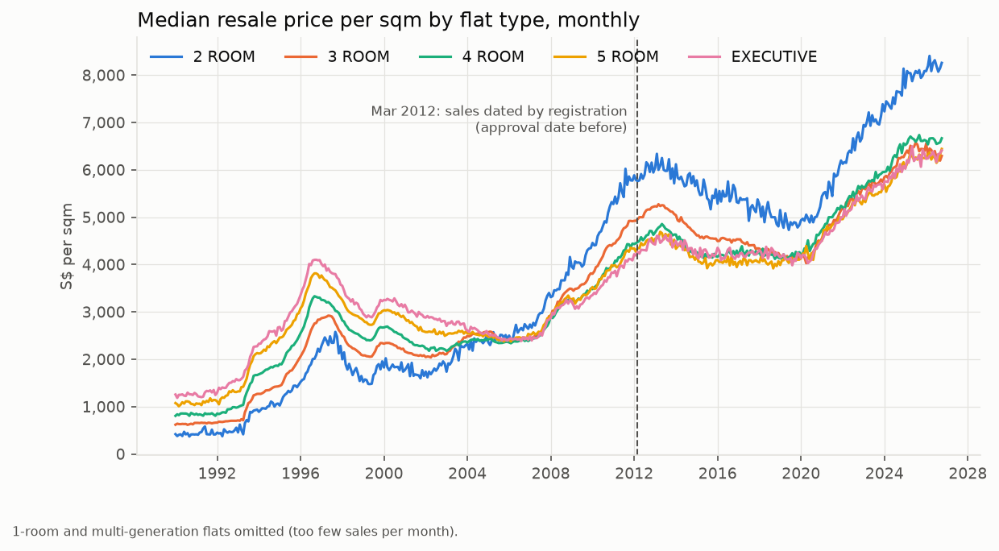
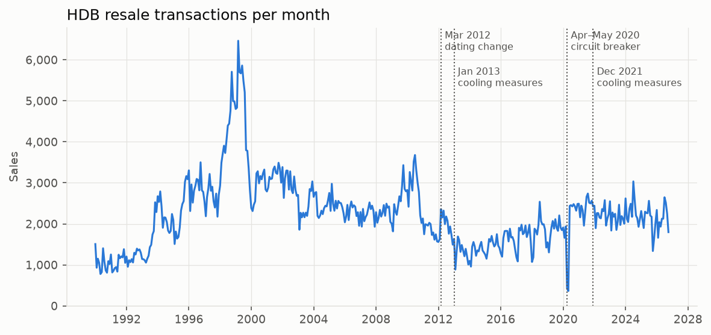
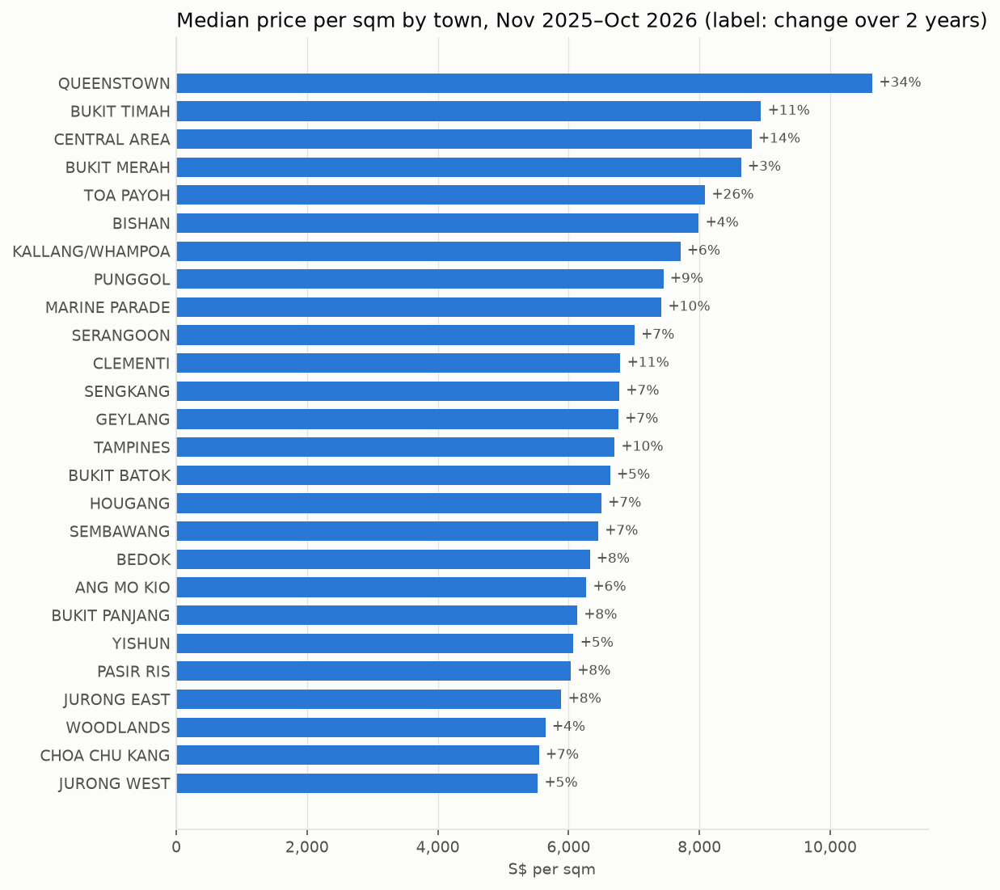
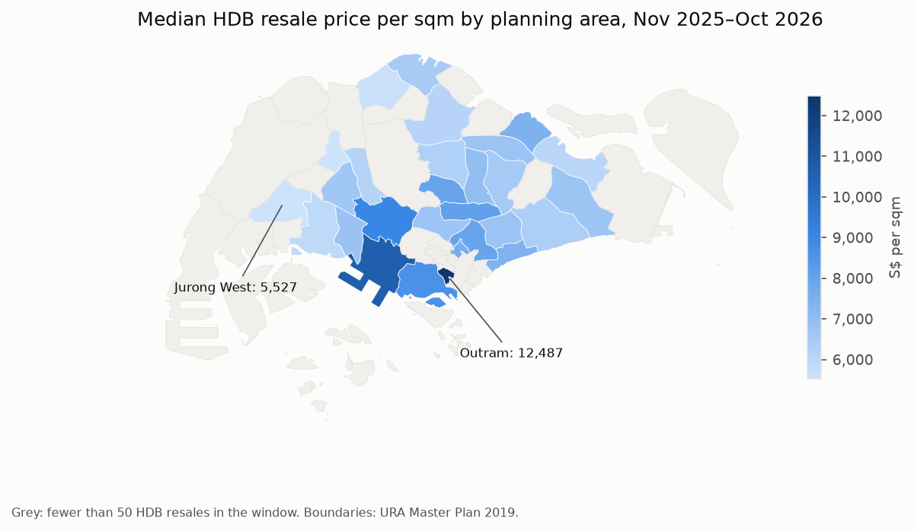
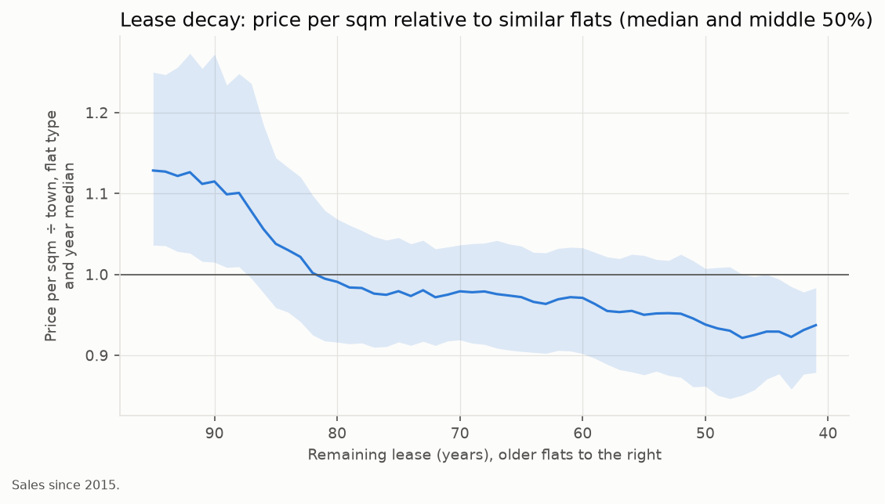
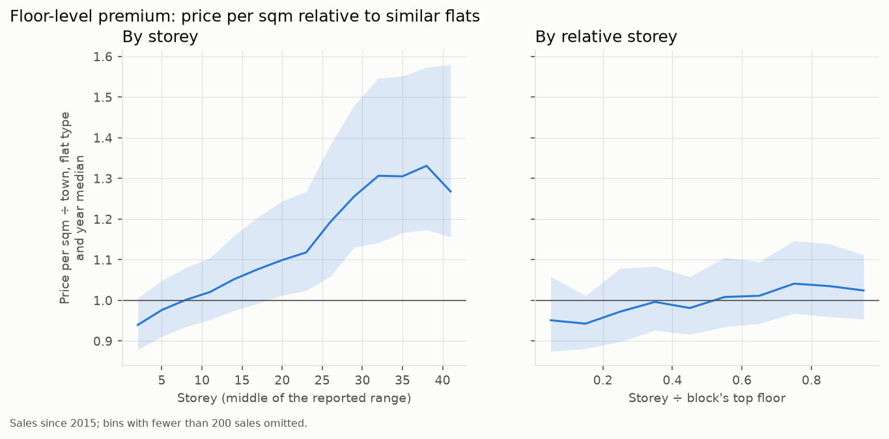
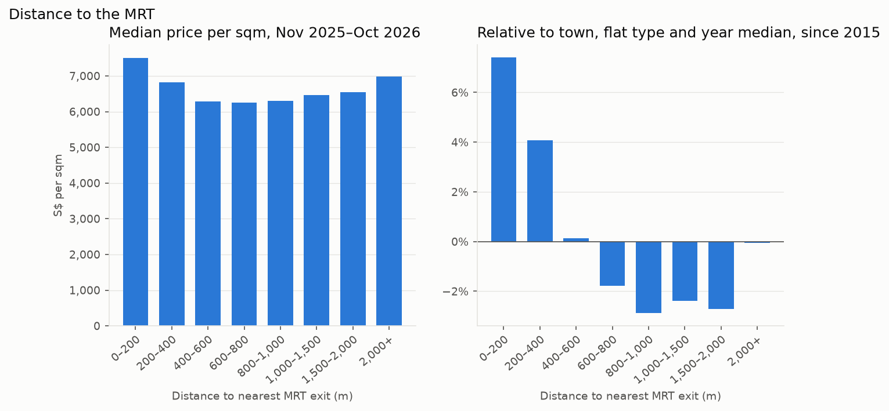
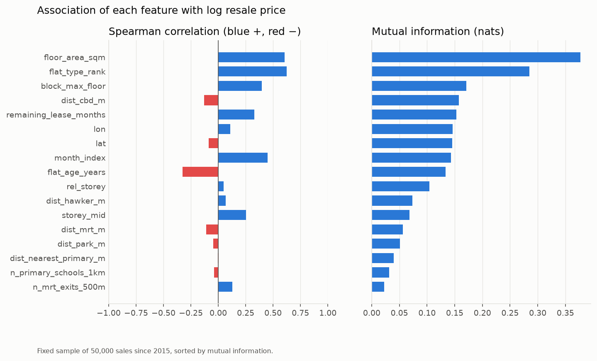

# Exploratory analysis: key findings

From the notebooks in `notebooks/` (run them with `make eda`), on 989,703 HDB resales from
January 1990 to October 2026. Prices are nominal Singapore dollars per square metre of floor
area. "Similar flats" means the median price per sqm of sales in the same town, flat type and
year. Each figure is also saved as SVG next to its PNG in `reports/figures/`.

## 1. Prices have been through three cycles, and are at a record

A 4-room flat's median price per sqm rose almost fourfold from 845 in 1990 to 3,332 in
September 1996. It then fell 35% to 2,178 by March 2002, and did not regain the 1996 level
until 2009. It peaked again at 4,856 in May 2013 and eased 15% to 4,118 by October 2018.
Since then it has risen 64%, to a record 6,735 in September 2025.

## 2. Smaller flats switched from cheapest to dearest per sqm

In 1995 price per sqm rose with flat size: 2-room 1,319, 3-room 1,735, 4-room 2,195, 5-room
2,671 and executive 2,943. The order had reversed by 2010, with 2-room at 4,757 and executive
at 3,558. In 2025, 2-room flats fetched 8,043 per sqm against 6,200–6,650 for the larger
types (same figure as finding 1). A model therefore needs flat type and floor area to
interact with time, not as fixed effects.

## 3. The March 2012 dating change leaves no visible step

Sales are dated by approval date before March 2012 and by registration date afterwards. None
of the price series shows a break at the dashed line in the figure for finding 1, so one
continuous series is usable, with `date_basis` kept as a feature in case the model finds a
small offset.

## 4. Volume tracks policy and shocks

Resales averaged 4,537 a month in 1998–1999 and peaked at 6,465 in March 1999. After the
January 2013 cooling measures they averaged only 1,590 a month from 2013 to 2019, the lowest
sustained level in the data. The April–May 2020 circuit breaker cut sales to 424 and 363, the
two lowest months on record. From 2021 to 2025 volume settled at about 2,240 a month.

## 5. Town prices span almost two to one

Over November 2025 to October 2026, Queenstown had the highest median at S$10,646 per sqm
and Jurong West the lowest at S$5,527. Most towns rose 4–11% over two years. Queenstown
(+34%) and Toa Payoh (+26%) stand out, but town medians mix old and new flats, so these jumps
may reflect newer flats entering the resale market rather than like-for-like growth.

## 6. Price falls with distance from the city centre

By planning area, Outram is highest at S$12,487 per sqm and Jurong West lowest at S$5,527.
The dearest areas form a band around the city centre (Outram, Bukit Merah, Queenstown).
Prices are lower towards the west and north, with the north-east and east in between. Areas
in grey had fewer than 50 HDB resales in the window.

## 7. Lease decay: a new-flat premium, then a slow decline

Flats with 93 or more years of lease left sell 12–13% above similar flats. That premium is
gone by about 82 years. After that, relative price declines slowly, to about 0.97 at 60 years
and 0.93 at 45–50 years. The middle 50% band is about ±7% wide throughout, so lease explains
only part of the spread.

## 8. The floor premium is mostly about tall blocks

By absolute storey, relative price rises from 0.94 on storeys 1–3 to 1.10 around storey 20
and 1.26–1.33 above storey 30. By storey relative to the block's top floor, it only rises
from about 0.95 to 1.04. Most of the absolute-storey premium therefore comes from the tall
blocks themselves (newer, often more central), not from height within a block. Both
`storey_mid` and `rel_storey` belong in the model.

## 9. Living near the MRT is worth about 7%, and fades within 600 m

Compared with similar flats, sales within 200 m of an MRT exit fetch 7.4% more and those at
200–400 m 4.1% more. At 400–600 m the premium is about zero, and from 600 m to 2 km prices sit
2–3% below similar flats with no further decline. The last bucket, beyond 2 km, is back at
about the median, but it holds only 3,823 of the 280,653 sales since 2015 (1.4%), too few to
read as a trend. The raw medians (left panel) are U-shaped
because distance there is mixed up with location: they show why the comparison needs to be
within town.

## 10. Size dominates; location matters non-linearly; amenity counts add little

On a fixed sample of 50,000 sales since 2015, floor area (mutual information 0.38) and flat
type (0.29) carry the most information about log price. Next come block height (0.17),
distance to the CBD (0.16), remaining lease (0.15), latitude and longitude (0.15 each) and
month (0.14). Distance to the CBD has a weak rank correlation (−0.13) but high mutual
information, so its effect is non-linear, which suits a tree model. Amenity counts and
distances (schools, parks, hawker centres, MRT exits within 500 m) each carry under 0.08.
Counts, storeys, block height and flat type are scored as discrete features.

## Caveats

- Amenity locations are today's. A station or hawker centre that opened in 2020 also counts
  for a 1995 sale.
- Medians mix flats of different ages and sizes, so shifts in what is sold move them as well
  as price changes.
- Prices are nominal, not adjusted for inflation.
